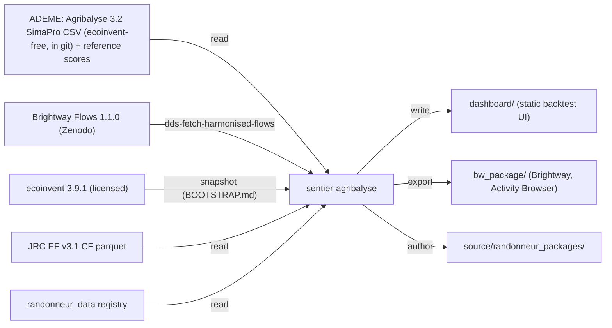
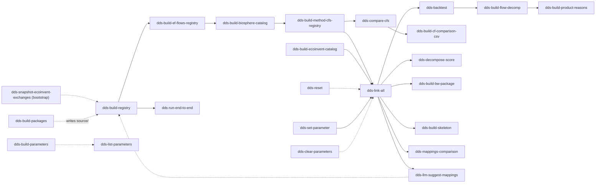

# sentier-agribalyse



Public, ecoinvent-EULA-clean adapter that brings Agribalyse 3.2 into Brightway 2.5.

## What it is

- Imports the ADEME Agribalyse 3.2 SimaPro CSV.
- Links it to ecoinvent 3.9.1 through a tiered `MappingRegistry`. Tiers are data, not code.
- Registers the 19 headline EF v3.1 LCIA methods and scores every product.
- Backtests every score against ADEME reference values in a static React dashboard.
- Exports the linked system as Brightway datapackages plus a standalone importer.

No proprietary ecoinvent data ships in git. The ecoinvent-derived files under `source/` and
`registry/method_cfs/` are gitignored and blocked by a pre-commit guard. Licensed users
regenerate them locally: see [BOOTSTRAP.md](BOOTSTRAP.md).

A clone plus an ecoinvent 3.9.1 licence is enough to run everything. The Agribalyse
inventories ship as `source/AGB32_ecoinvent_free.CSV.xz`: see
[The Agribalyse CSV](#the-agribalyse-csv).

Deep dives (mapping tiers, registry contract, link sequence, solver notes) live in the DdS wiki
page `sentier-agribalyse`.



## Prerequisites

- Python 3.11+ and [uv](https://docs.astral.sh/uv/).
- Network access once, for `dds-fetch-harmonised-flows` (46 MB from Zenodo).
- An ecoinvent 3.9.1 licence to regenerate the gitignored `source/` files. Credentials go in `.env` as `ECOINVENT_USERNAME` and `ECOINVENT_PASSWORD`. Bootstrap only: see [BOOTSTRAP.md](BOOTSTRAP.md).
- The `pardiso` extra for scoring. scipy rejects the matrix's zero-diagonal placeholder activities as "exactly singular".

## Install

```bash
uv sync --extra pardiso
```

Add `--extra bw` for the Brightway export, `--extra test` for pytest, `--extra bootstrap` to snapshot ecoinvent, `--extra llm-api` for `--use-api`. pip works too: `pip install -e ".[pardiso]"`.

Activate the EULA guard once per clone:

```bash
pre-commit install
```

## Use

Run every script as `uv run <script>`.

| Command | What it does |
|---|---|
| `dds-snapshot-ecoinvent-exchanges` | Bootstrap only. Dump ecoinvent exchanges from a bw2data SQLite into `source/`. |
| `dds-fetch-harmonised-flows` | Download the pinned Brightway Flows list into `source/` and check its sha256. Once per clone. `--force`. |
| `dds-build-registry` | Build `registry/*.parquet` from every `source/` artifact. Run after the fetch. |
| `dds-strip-ecoinvent` | Maintainers only. Rebuild `source/AGB32_ecoinvent_free.CSV.xz` and its manifest from ADEME's full export. |
| `dds-build-ef-flows-registry` | Write `registry/ef_flows.parquet`, the EF flow universe. |
| `dds-build-biosphere-catalog` | Write `registry/biosphere_catalog.parquet` from the biosphere snapshots. |
| `dds-build-method-cfs-registry` | Write `registry/method_cfs/`, per-method CF parquets plus index. |
| `dds-build-ecoinvent-catalog` | Write `registry/ecoinvent_catalog.parquet` from the activity snapshot. |
| `dds-build-parameters` | Write `registry/parameters.parquet` and `registry/exchange_formulas.parquet` from the CSV. |
| `dds-build-packages` | Author the randonneur datapackages in `source/randonneur_packages/` and the residuals review xlsx. |
| `dds-link-all` | Full link pipeline. Writes the scoring package and `dashboard/run_report.json`. |
| `dds-run-end-to-end` | Smoke test: link, register LCIA, score a small sample. |
| `dds-backtest` | Score every mapped product against ADEME. Writes `dashboard/backtest/` and `dashboard/backtest_pass1.csv`. |
| `dds-compare-cfs` | SimaPro-vs-registry per-flow CF comparison. Writes `dashboard/cf_comparison.csv`. |
| `dds-build-cf-comparison-csv` | Re-flatten `registry/cf_comparison_join.parquet` into `dashboard/cf_comparison.csv`. |
| `dds-build-flow-decomp` | Per-product flow-decomposition JSONs in `dashboard/decomp/`. |
| `dds-build-product-reasons` | LLM outlier notes in `dashboard/product_reasons.json`. Needs the `claude` binary or `--use-api`. |
| `dds-decompose-score` | Explain one `(product, method)` score: top biosphere-flow contributions. |
| `dds-build-bw-package` | Export `bw_package/`: bw_processing datapackages plus a standalone Brightway importer. Needs the `bw` extra. |
| `dds-build-skeleton` | Strip ecoinvent amounts from a scoring package into an AGB-only skeleton. |
| `dds-mappings-comparison` | Regenerate `to_review/mappings_comparison.xlsx` from the cached link. |
| `dds-llm-suggest-mappings` | LLM picks for residual unlinked flows. Appends accepted rows to the reviewed xlsx. |
| `dds-set-parameter` | Override a SimaPro input parameter, then relink and rescore. `--fast`, `--no-rescore`. |
| `dds-list-parameters` | Browse SimaPro parameter names, ranges, and active overrides. `--name-like`. |
| `dds-clear-parameters` | Remove overrides: all, `--name`, or `--product`. |
| `dds-reset` | Delete caches and overrides so the next link re-parses the CSV. `--keep-overrides`. |

Flags worth knowing:

- `--solver pardiso` on `dds-backtest`, `dds-run-end-to-end`, `dds-decompose-score`. Already the default on `dds-build-flow-decomp` and `dds-set-parameter`.
- `--skip-ecoinvent` on `dds-link-all` and `dds-run-end-to-end`; `--skip-linking` on `dds-run-end-to-end`.
- `--no-llm` on `dds-link-all` disables LLM overrides and the curated synonym fallback.

## Typical workflow

1. Licensed users, once: regenerate the ecoinvent-derived `source/` files per [BOOTSTRAP.md](BOOTSTRAP.md).
2. Fetch the flow list, once: `uv run dds-fetch-harmonised-flows`.
3. Build the registry: `uv run dds-build-registry`, then `dds-build-ef-flows-registry`, `dds-build-biosphere-catalog`, `dds-build-method-cfs-registry`, `dds-build-ecoinvent-catalog`.
4. Link: `uv run dds-link-all`.
5. Score: `uv run dds-backtest --solver pardiso`.
6. Dashboard data: `uv run dds-compare-cfs`, then `uv run dds-build-flow-decomp`.
7. Optional tooltips: `uv run dds-build-product-reasons`.
8. View: `python -m http.server 8000 --directory dashboard`, then open `http://localhost:8000/backtest_dashboard.html`.
9. Optional export: `uv run dds-build-bw-package` (needs the `bw` extra). `bw_package/` embeds ecoinvent data; it is gitignored and blocked by the guard.

After replacing the SimaPro CSV run `uv run dds-reset`, then repeat from step 4.

## The Agribalyse CSV

ADEME's SimaPro export of Agribalyse 3.2 embeds 2,264 ecoinvent datasets as process blocks named `… - Copied from Ecoinvent U`. Those are licensed ecoinvent data, so the export cannot be published as is.

What ships is `source/AGB32_ecoinvent_free.CSV.xz`: the same export with those 2,264 blocks removed, 18,176 processes kept, every other byte untouched. The `… - Adapted from Ecoinvent U` processes are ADEME's own modified datasets and stay, as in the Agribalyse 4.0 "without ecoinvent" export. `source/agribalyse-3.2-stripped-ecoinvent-processes.json` lists each removed block by SimaPro identifier, type and sha256, with no names and no amounts.

The pipeline links every input that pointed at a removed copy to the same activity in your own ecoinvent 3.9.1. Three inputs stay unlinked, one exchange each: two ADEME combustion extracts with no ecoinvent counterpart and one rye feed dataset whose name is ambiguous. Eleven `recycling of …` treatments are empty in the cut-off model and are dropped without effect.

Which file is read:

- `source/AGB32_final.CSV` (ADEME's full export), when you have it. It is gitignored and the guard refuses it.
- Otherwise the shipped archive, decompressed once into `cache/`.

`dashboard/run_report.json` records the variant under `stages.csv_source`.

Scores with the shipped file are not identical to scores with the full export. SimaPro's embedded copies are pre-aggregated inventories characterised through the Agribalyse-side flow mapping; your ecoinvent download is characterised through ecoinvent's own EF v3.1 implementation. Share of the 2,451 backtested products within ±5% of ADEME's reference, shipped file against full export (the full-export column uses the flow list this project was tuned on, an April 2026 pre-release of Brightway Flows; with release 1.1.0 the three toxicity rows of that column drop as well):

| Close to the full export | Shipped | Full |
|---|---|---|
| Climate change | 99.2% | 99.8% |
| Climate change, fossil / biogenic / land use change | 98.8% / 99.8% / 100.0% | 99.5% / 99.8% / 100.0% |
| Ionising radiation | 99.8% | 100.0% |
| Photochemical ozone formation | 99.3% | 100.0% |
| Particulate matter | 98.6% | 98.8% |
| Acidification | 93.0% | 93.6% |
| Eutrophication, freshwater / marine / terrestrial | 99.8% / 99.3% / 95.6% | 100.0% / 100.0% / 96.2% |
| Energy resources / material resources | 99.8% / 99.8% | 100.0% / 100.0% |

| Further from the full export | Shipped | Full |
|---|---|---|
| Ozone depletion | 83.1% | 100.0% |
| Land use | 66.3% | 100.0% |
| Water use | 21.9% | 29.6% |
| Human toxicity, non-carcinogenic / carcinogenic | 40.4% / 22.4% | 93.1% / 43.0% |
| Ecotoxicity, freshwater | 38.6% | 52.4% |

Maintainers holding the full export rebuild the archive with `uv run dds-strip-ecoinvent`. It fails if any process of the aggregated-process deletion list survives, and `tests/integration/test_ecoinvent_free_csv_shipped.py` audits the committed file.

## Changing parameters (no SimaPro required)

AGB 3.2's SimaPro process-level parameters (577 names across 13,725 processes, packaging stage included) are editable from the command line. Only input parameters accept overrides; calculated parameters are formula-derived and refuse with their formula.

```bash
uv run dds-list-parameters --name-like packaging                          # names, counts, value ranges, active overrides
uv run dds-set-parameter Packaging_Weight 0.03 --product EI3CQUNI000025017101234
uv run dds-set-parameter Packaging_Weight 0.03 --all-products             # every process that defines it
uv run dds-clear-parameters                                               # back to the baseline
```

`dds-set-parameter` writes the override to `source/parameter_overrides.csv` (gitignored; a process-specific row beats a `*` row), prints the changed exchange amounts, then reruns `dds-link-all` and `dds-backtest` so the dashboard shows the scenario. `--no-rescore` skips the rerun. `--fast` replays only the scoring-package stage against the cached linked graph (`cache/linked_cache.pkl`) and ratio-patches the amounts; exchanges whose baseline evaluates to 0 are reported and need the full path. Baseline and what-if scoring packages coexist in `cache/scoring_packages/` because the content hash covers the amounts. `dds-reset` deletes the overrides file unless you pass `--keep-overrides`.

Rebuilds are deterministic: after `dds-clear-parameters` the next run reproduces the original scores exactly. This is verified on the full 2,451-product backtest.

### Changing parameters in SimaPro instead

For structural edits (new parameters, changed formulas), edit in SimaPro, re-export with the original settings, replace `source/AGB32_final.CSV`, then run `uv run dds-reset`, `uv run dds-link-all`, `uv run dds-backtest`. `dds-reset` is required because the CSV parse cache does not hash the source file.

## Layout

```
source/        inputs + the randonneur packages we publish (ecoinvent-derived files gitignored)
registry/      built mapping parquets, single source of mapping truth (gitignored, regenerable)
cache/         parquet caches, importer pickle, scoring packages (gitignored)
dashboard/     static React UI + backtest_pass1.csv (committed); other generated data gitignored
to_review/     human-review artifacts
unlinked/      residual unlinked exports
bw_package/    Brightway export (gitignored, EULA-guarded)
src/           the package, flat layout: cli/, registry/, matching/, transforms/, ef/, scoring/,
               reporting/, pipelines/, bw_export/, bw_import/, exports/, llm/
tests/         pytest suite: unit/, integration/, fixtures/
.githooks/     pre-commit ecoinvent EULA guard
BOOTSTRAP.md   how a licensed user regenerates the gitignored source/ files
```

## Licence

Code: MIT (`pyproject.toml`). ecoinvent data is licensed separately and never ships in this
repo; regenerated files stay local under the ecoinvent EULA.

Agribalyse 3.2 is published by ADEME under the Etalab Open Licence 2.0; the shipped CSV is that
export without its embedded ecoinvent datasets. The flow list fetched by
`dds-fetch-harmonised-flows` is Brightway Flows 1.1.0,
[doi:10.5281/zenodo.23554066](https://doi.org/10.5281/zenodo.23554066), under ODbL.
